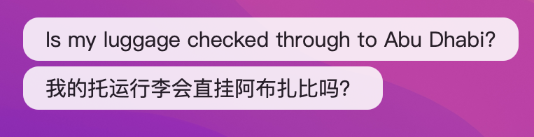
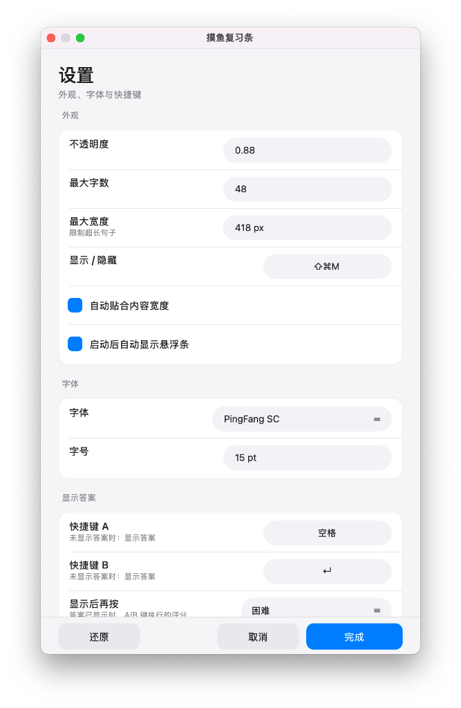

# Moyu Anki Overlay

[English](README.md) | [中文](README.zh-CN.md)

A minimal always-on-top review pill for the desktop, powered by Anki’s official scheduler — quiet card review while you work or sit in meetings.

By default only the **question** is shown. Hover or press a shortcut to reveal the answer, then grade with number keys / Space. Reviews are written into your current Anki collection and sync normally to AnkiWeb.

> **Requires Anki to be running** (main window may be minimized). Primarily tested on **macOS**; Windows works too (change the font in Settings).

---

## Screenshots

**Overlay** — question only, then hover / shortcut to reveal the answer:



**Settings** — appearance, fonts, and shortcuts:



---

## Features

| | |
| --- | --- |
| Overlay | Frameless, always-on-top, translucent white pill |
| Question-first | Collapsed state shows front-side plain text only |
| Reveal | Hover, or keyboard shortcuts |
| Grading | Digits / Space after reveal (configurable) |
| Deck | Follows the deck currently selected in Anki |
| Plain text | Strips HTML, `[[type:…]]`, ruby tags, etc. |
| Settings | Appearance, fonts, shortcuts in a GUI |

**Not in v1:** images / audio, cloze highlighting, full template rendering, standalone app without Anki.

---

## Requirements

- Anki **25.09+** (verified on **Anki 26.09** / macOS)
- No extra Python/Qt install — use Anki’s bundled runtime
- Prefer exiting the main Reviewer before using the overlay (avoids dual scheduling; overlay auto-pauses when you enter main review)

---

## Install

### A. From AnkiWeb (recommended, once listed)

1. Open Anki → **Tools → Add-ons → Get Add-ons…**
2. Paste the code from the add-on’s AnkiWeb page
3. Restart Anki

### B. From this repo

1. Download ZIP from GitHub → unzip (e.g. `moyu-anki-overlay`)
2. Anki → **Tools → Add-ons → View Files** → opens `addons21`
3. Copy the folder in as `moyu_anki_overlay` (must contain `__init__.py` at the top level):

```text
addons21/moyu_anki_overlay/
  __init__.py
  overlay.py
  review_controller.py
  config_dialog.py
  config.json
  manifest.json
  ...
```

4. Fully quit and restart Anki
5. Under **Tools** you should see **Show/Hide Moyu Overlay** and **Moyu Overlay Settings…**

### C. Symlink (dev)

```bash
ln -sfn /path/to/moyu-anki-overlay \
  "$HOME/Library/Application Support/Anki2/addons21/moyu_anki_overlay"
```

Windows (admin PowerShell):

```powershell
New-Item -ItemType SymbolicLink `
  -Path "$env:APPDATA\Anki2\addons21\moyu_anki_overlay" `
  -Target "D:\path\to\moyu-anki-overlay"
```

---

## Usage

1. Start Anki and select a deck with due cards
2. If auto-show is on, a pill appears near the top; otherwise **Tools → Show/Hide Moyu Overlay** (default `Ctrl+Shift+M` / `⌃⇧M`)
3. **Reveal answer:** hover, or press reveal shortcuts (default Space / Enter), or a grade digit (also reveals when hidden)
4. **Grade** (answer visible): `1` Again · `2` Hard · `3` Good · `4` Easy; Space/Enter grades per “After reveal” setting (default Good)
5. After grading, if the cursor stays on the pill, the next answer stays hidden until you **leave and re-enter**
6. Drag the pill to reposition (saved in config)

```text
Question → Space/hover to reveal → 1–4 to grade → move mouse away → next card
```

---

## Settings

**Tools → Moyu Overlay Settings…** or **Tools → Add-ons → Moyu → Config**

| Group | Option | Meaning |
| --- | --- | --- |
| Appearance | Opacity | Pill transparency |
| Appearance | Max chars / max width | Truncate long text |
| Appearance | Show/Hide hotkey | Global toggle |
| Appearance | Hug content width | Frame shrinks to text |
| Appearance | Auto-show on start | Show after profile load |
| Font | Family / size | On Windows prefer a system CJK font |
| Reveal | Shortcuts A / B | Default Space, Enter |
| Reveal | After reveal | Grade when A/B pressed while answer shown |
| Grade | Again/Hard/Good/Easy | Digit (etc.) shortcuts |

---

## Notes

1. Anki must be running for reviews to be saved and synced.
2. Shortcuts only work when Anki can receive keys; hovering the pill grabs focus when possible.
3. Don’t run main Reviewer and overlay together; overlay hides during main review.
4. Content is plain text of rendered front/back — no full templates, images, or audio.

---

## Publish to AnkiWeb

Official docs: [Sharing Add-ons](https://docs.ankiweb.net/addons/sharing)

1. Build a `.ankiaddon` (zip of **folder contents**, not the folder itself; no `__pycache__`):

```bash
cd /path/to/moyu-anki-overlay
./pack-ankiaddon.sh
# → dist/moyu_anki_overlay.ankiaddon
```

2. Log in at [AnkiWeb](https://ankiweb.net/)
3. Open [Share Add-on](https://ankiweb.net/shared/upload)
4. Fill **Title** (≤80 chars), optional tags / support URL, supported Anki version branches, and a **Description** (Markdown/HTML OK — you can paste CN+EN)
5. Upload the `.ankiaddon` file
6. After approval listing, users install via **Get Add-ons…** with the numeric code on your add-on page

Updates: upload a new `.ankiaddon` on the same add-on page (same code). There is **no public upload API** — use the website.

---

## Project layout

```text
moyu-anki-overlay/
├── __init__.py
├── overlay.py
├── review_controller.py
├── config_dialog.py
├── config.json
├── config.md
├── manifest.json
├── pack-ankiaddon.sh      # build .ankiaddon for AnkiWeb
├── docs/screenshots/      # README screenshots
├── README.md
└── README.zh-CN.md
```

---

## Dev

- Restart Anki after code changes
- `moyu_debug.log` may appear locally (gitignored)
- Do not commit `meta.json` (user config / position)

---

## License

Personal/learning tool. Free to modify and use; if you redistribute, please keep attribution.

---

## Feedback

Issues welcome: install failures, shortcut issues, text-cleaning edge cases.
