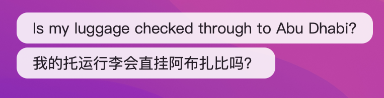
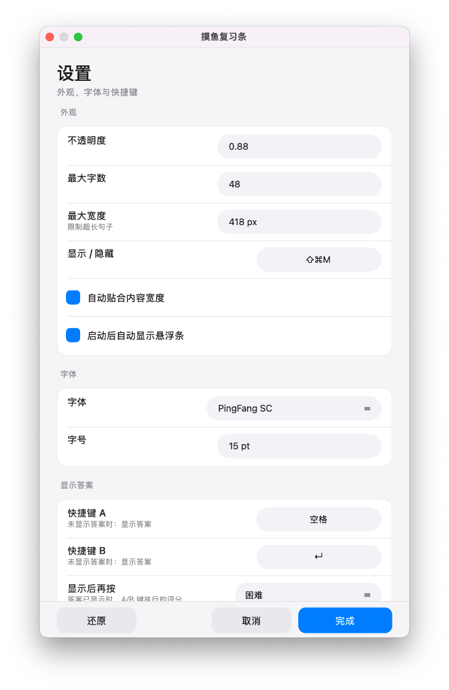

# 摸鱼复习条（Moyu Anki Overlay）

[English](README.md) | [中文](README.zh-CN.md)

桌面极简胶囊复习条，用 Anki 官方调度刷卡——开会、写代码时也能「低调」复习。

默认只显示**问题**；悬停或快捷键显示答案；再用数字键 / 空格评分。复习写入当前集合，可正常同步 AnkiWeb。

> **需要 Anki 保持运行**（主窗口可最小化）。以 **macOS** 为主；Windows 也可使用（请在设置里改成系统字体）。

---

## 截图

**悬浮条** — 默认只显示问题，悬停 / 快捷键显示答案：



**设置** — 外观、字体与快捷键：



---

## 功能

| | |
| --- | --- |
| 悬浮条 | 无边框、置顶、不透明白胶囊，普通文字纯黑 |
| 先看问题 | 收起时只显示正面纯文本 |
| 看答案 | 悬停或快捷键 |
| 评分 | 显示答案后用数字键 / 空格评分（可配置） |
| 牌组 | 跟 Anki 里当前选中的牌组 |
| 纯文本 | 去掉 HTML、`[[type:…]]`、音标标签等 |
| 设置 | 外观、字体、快捷键图形设置 |

**首版不做：** 图片 / 音频、填空高亮、完整模板渲染、不依赖 Anki 的独立应用。

---

## 环境

- Anki **25.09+**（在 **Anki 26.09** / macOS 验证）
- 无需额外依赖——使用 Anki 自带运行时
- 建议先退出主界面「复习」再使用悬浮条（进入主界面复习时会自动暂停，避免双重调度）

---

## 安装

### A. 从 AnkiWeb（推荐，上架后）

1. Anki → **工具 → 插件 → 获取插件…**
2. 粘贴 AnkiWeb 页面上的插件代码
3. 重启 Anki

### B. 从本仓库

1. GitHub 下载 ZIP 并解压（例如 `moyu-anki-overlay`）
2. **工具 → 插件 → 查看文件**，打开 `addons21`
3. 放入并命名为 `moyu_anki_overlay`（顶层要有 `__init__.py`）：

```text
addons21/moyu_anki_overlay/
  __init__.py
  overlay.py
  review_controller.py
  config_dialog.py
  config.json
  manifest.json
  ...
```

4. **完全退出再打开 Anki**
5. **工具** 菜单应出现「显示/隐藏摸鱼复习条」「摸鱼复习条设置…」

### C. 符号链接（开发）

```bash
ln -sfn /path/to/moyu-anki-overlay \
  "$HOME/Library/Application Support/Anki2/addons21/moyu_anki_overlay"
```

Windows（管理员 PowerShell）：

```powershell
New-Item -ItemType SymbolicLink `
  -Path "$env:APPDATA\Anki2\addons21\moyu_anki_overlay" `
  -Target "D:\path\to\moyu-anki-overlay"
```

---

## 使用

1. 打开 Anki，选中有到期卡的牌组
2. 若开启自动显示，顶部附近会出现胶囊；否则用 **工具 → 显示/隐藏摸鱼复习条**（默认 `Ctrl+Shift+M` / `⌃⇧M`）
3. **看答案：** 悬停并自动聚焦，或按显示答案快捷键（默认空格 / 回车），或按评分数字键（未显示时也会先显示）
4. **触摸板评分：** 答案显示后单击默认选择“良好”；双击隐藏且不评分，拖动不评分。可在设置的「触摸板 / 鼠标 → 单击评分」修改难度。为区分双击，单击评分会等待系统双击间隔。
5. **键盘评分：** `1` 重来 · `2` 困难 · `3` 良好 · `4` 简单；空格/回车按「显示后再按」执行（默认良好）
5. 答完后下一题先收起答案；可立即按键继续，**不必移开或点击鼠标**。自动悬停则需移开再移回来
6. 按住任意文字区域拖动改位置，双击快速隐藏；拖动左右边缘调宽（默认 330 px，写入配置）；备注优先完整展开，仅超出屏幕剩余空间时滚动

```text
看到问题 → 空格看答案 → 1–4 评分 → 下一题 → 空格继续
```

---

## 设置

**工具 → 摸鱼复习条设置…** 或 **工具 → 插件 → 摸鱼复习条 → 配置**

| 分组 | 选项 | 含义 |
| --- | --- | --- |
| 外观 | 透明度 | 默认完全不透明，可手动调整 |
| 外观 | 卡片宽度 | 默认 330 px；自动换行，内容不截断 |
| 外观 | 显示/隐藏快捷键 | 全局显示隐藏 |
| 外观 | 启动后自动显示 | 加载配置后自动显示 |
| 字体 | 字体 / 字号 | Windows 建议系统中文字体 |
| 显示答案 | 快捷键 A / B | 默认空格、回车 |
| 显示答案 | 显示后再按 | 答案已显示时 A/B 的评分 |
| 评分 | 重来/困难/良好/简单 | 数字键等快捷键 |

---

## 注意事项

1. Anki 必须在运行，复习才会保存并同步。
2. 悬停显示答案并聚焦浮条；键盘可直接继续操作。
3. 不要与主界面复习同时进行；进入主界面复习时悬浮条会隐藏。
4. 使用卡片渲染后的 HTML/CSS，保留原模板的分段、加粗、列表及笔记样式，仅隐藏字段颜色标签和输入检测控件。普通文字纯黑，保留显式彩色标注；备注尽量完整显示，仅超出屏幕剩余空间时滚动；模板脚本不在悬浮卡片内执行。问题使用同一个 DOM 节点，展开不缩放窗口、不切换透明度；未使用的透明区域不拦截点击。

---

## 发布到 AnkiWeb

官方文档：[Sharing Add-ons](https://docs.ankiweb.net/addons/sharing)

1. 打出 `.ankiaddon`（压缩**文件夹内容**，不是文件夹本身；不要包含 `__pycache__`）：

```bash
cd /path/to/moyu-anki-overlay
./pack-ankiaddon.sh
# → dist/moyu_anki_overlay.ankiaddon
```

2. 登录 [AnkiWeb](https://ankiweb.net/)
3. 打开 [上传页](https://ankiweb.net/shared/upload)
4. 填写 **Title**（≤80 字符）、可选标签 / 支持链接、支持的 Anki 版本分支，以及 **Description**（可用 Markdown/HTML，可中英双语）
5. 上传 `.ankiaddon` 文件
6. 上架后，用户通过 **获取插件…** 使用插件页上的数字代码安装

更新：在同一插件页重新上传新的 `.ankiaddon`（代码不变）。**没有公开上传 API**，请使用网站。

---

## 项目结构

```text
moyu-anki-overlay/
├── __init__.py
├── overlay.py
├── review_controller.py
├── config_dialog.py
├── config.json
├── config.md
├── manifest.json
├── pack-ankiaddon.sh      # 打包 .ankiaddon 用于 AnkiWeb
├── docs/screenshots/      # README 截图
├── README.md
└── README.zh-CN.md
```

---

## 开发

- 改代码后需重启 Anki
- 本地可能出现 `moyu_debug.log`（已 gitignore）
- 不要提交 `meta.json`（用户配置 / 位置）

---

## 许可

个人学习工具，可自由修改使用；公开分发请保留来源说明。

---

## 反馈

欢迎提 Issue：安装失败、快捷键问题、文本清洗边界情况等。
